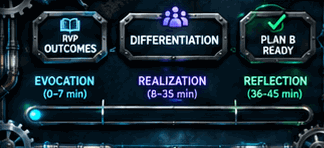

# Smart Prompt: Structured Lesson Plan Generator

> Article and context on Vibemaker: [Structured Lesson Plan Generator](https://vibemaker.cz/clanek/generator-vyukovych-priprav-rvp/)

[Česky](README.cs.md)

A classroom lesson-planning prompt for teachers and trainee educators that produces minute-by-minute 45- or 90-minute lesson plans using the E-U-R model, measurable student action verbs and ready-to-use materials.

## Run

1. Open [en/smart-lesson-plan-generator.md](en/smart-lesson-plan-generator.md) (or the Czech edition [cs/smart-prompt-generator-vyukovych-priprav-v-souladu-s-rvp.md](cs/smart-prompt-generator-vyukovych-priprav-v-souladu-s-rvp.md)).
2. Copy the entire Markdown content and paste it as a system prompt or first message in your AI assistant (ChatGPT, Claude, Gemini or a compatible workflow).
3. Answer the Phase 1 entry diagnostic questions supplied by the assistant. Phase 6 stop-guard ensures the AI greets you and asks the 5 diagnostic questions from Phase 1 before generating any plan.

## Features

The timing review includes transitions and material setup. Each objective has a practice slot, observable evidence and a success criterion. The prompt requests an editable DOCX where the chat can create files and copyable Markdown otherwise. File generation and model behaviour for this version have no documented test yet.

Timing review inspiration: [Lesson Plan Designer and Timing Checker](https://prompts.chat/prompts/cmuz82k2l000njy045jzh27v0_lesson-plan-designer-and-timing-checker), @f, prompts.chat (CC0 1.0).

- Strict 45-minute or 90-minute schedule following the E-U-R (Evocation, Realization of Meaning, Reflection) arc.
- Measurable student action verbs and SMART objectives paired with a board-ready student-facing objective.
- Deliberate taxonomy choice across Bloom's cognitive, psychomotor (labs/workshops) or affective domains.
- Concrete formative assessment tools, SEN/EAL differentiation, extension tasks and a realistic Plan B contingency.
- Requires a genuinely drafted copy-ready worksheet, exit ticket or 3–5 problems with an answer key (item 10).

## What it is not

This repository is a prompt specification, not a curriculum database or automated school-administration tool. Curriculum standards must be supplied or confirmed by the teacher.

## Languages

The English edition (`en/smart-lesson-plan-generator.md`) is curriculum-neutral; the Czech edition (`cs/smart-prompt-generator-vyukovych-priprav-v-souladu-s-rvp.md`) integrates Czech RVP ZV/G/SOV, key competencies and ČŠI inspection criteria.

## Data and privacy

Static Markdown files only. No data collection, telemetry or external dependencies.

## Files

| File | Purpose |
|---|---|
| [en/smart-lesson-plan-generator.md](en/smart-lesson-plan-generator.md) | English prompt edition |
| [cs/smart-prompt-generator-vyukovych-priprav-v-souladu-s-rvp.md](cs/smart-prompt-generator-vyukovych-priprav-v-souladu-s-rvp.md) | Czech prompt edition |
| [README.md](README.md) | English documentation |
| [README.cs.md](README.cs.md) | Czech documentation |
| [CHANGELOG.md](CHANGELOG.md) | Release history |
| [LICENSE](LICENSE) | CC0 1.0 Universal dedication |

## License and author

Dedicated to the public domain under [CC0 1.0 Universal](LICENSE). Author credit is informational.

### Author

**Luděk Sušický** — biologist, secondary-school and university teacher of computing subjects

- E-mail: [ludek.susicky@gmail.com](mailto:ludek.susicky@gmail.com)
- X: [@ludeksusicky](https://x.com/ludeksusicky)
- LinkedIn: [Luděk Sušický](https://www.linkedin.com/in/ludek-susicky/)
- GitHub: [@siberius](https://github.com/siberius) — more educational projects and open-source applications

[GitHub repository](https://github.com/siberius/smart-lesson-plan-generator)
